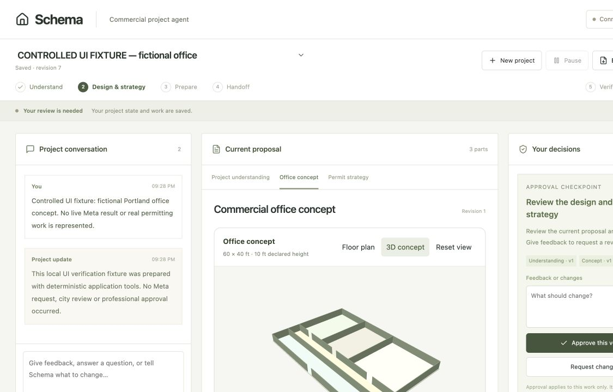

# Verification evidence — October 29, 2026

## Automated checks

- `npm test`: **172 passing, zero failing**. Includes actual SQLite persistence/lease/CAS tests, real PDF.js extraction and controlled-provider agent/mail tests.
- `npm run build`: TypeScript and the supported Vinext production build pass.
- `npm run validate`: built Worker parses; original Site identity, DB/R2 declarations and append-only migrations are packaged.
- A fictional stage lifecycle exercises understanding, concept/strategy, preparation, handoff, revision and approval dependencies with controlled Meta-shaped responses. It is **not authenticated Meta evidence**.
- Duplicate delivery, saved-response recovery, exact email approval, failed/uncertain sends, preference deletion suppression, pause/resume budgets and immutable R2 project snapshots have targeted checks.

## Local runtime and browser checks

- Local D1 migrations applied; actual built Worker creates a project, confirms its R2 version snapshot write and returns the same saved ID on readback.
- Both `/` and `/legacy` return HTTP 200 from the built Worker with server rendering. Three.js loads only in the browser, avoiding its global AbortController initialization in the Worker renderer.
- A valid one-page fictional PDF uploads, extracts its page text and records the source. Missing Meta upload configuration remains an explicit warning.
- Browser sign-in, brief creation, reload persistence, PDF upload, page provenance and HTML handoff download exercised.
- Linked commercial floor plan and real WebGL 3D cutaway rendered using a clearly labeled **local controlled UI fixture**. An invalid room width was rejected. A valid room edit created concept revision 2 and removed the previous pending approval, requeuing design work.
- Screenshot below is this controlled fixture, not a live Meta-generated proposal.

## Remaining live acceptance

- The hosted runtime key is not configured. A key used by the old tab-only prototype is not unattended runtime configuration. No authenticated Meta document/tool/revision run is claimed here.
- Cloud runner reachability, schedule creation, persisted heartbeat and actual closed-tab stage advancement are separate checks. A heartbeat is not evidence of completed inference.
- Sites Gmail eligibility and account consent have not been established. The tested adapter interface is not a live Gmail integration; no delivery receipt is claimed.
- Judge access, the final three-minute recording and submission remain unfinished. The development Site remains private, while source is public.
- No practitioner validation, city submission, permit issuance, professional certification or physical completion has been established.

Publication details and exact source checksums are included in the separate share-package release manifest. Local tests do not establish production readiness.
